# Deep Synth

A multi-agent research system. Give it a technical question ("Compare PostgreSQL pgvector vs Qdrant performance"); a team of LangGraph agents plans the research, reads the web in parallel, critiques its own coverage, **verifies every quote against the source text**, and writes a cited Markdown brief, streamed live to a Next.js UI.

It costs nothing to develop: the whole loop runs on a local 7B model through Ollama. In production it runs on the Google AI Studio Gemini API free tier.

Real outputs, produced entirely locally by `qwen2.5:7b` using DuckDuckGo search: [pgvector vs Qdrant](docs/sample-report-ollama.md) and [SQLite for multi-tenant SaaS](docs/sample-report-sqlite.md).

## Screenshots

Every screenshot below comes from a real local run on an 8 GB M1 with `qwen2.5:7b`; none are mock-ups.

**Ask a question.** Earlier briefs are kept in history.

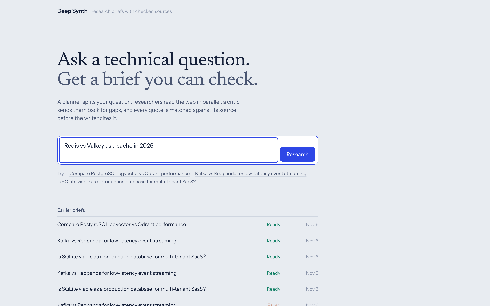

**Watch the agents work.** The planner splits the question, and four researchers read the web in parallel. Each lane shows its findings and the domains it read.

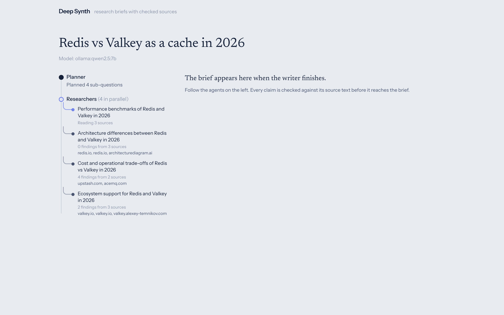

**Get a brief you can check.** It includes a TL;DR, comparison tables, inline citations, and a verifier bar showing how many quotes matched their source text. It downloads as Markdown.

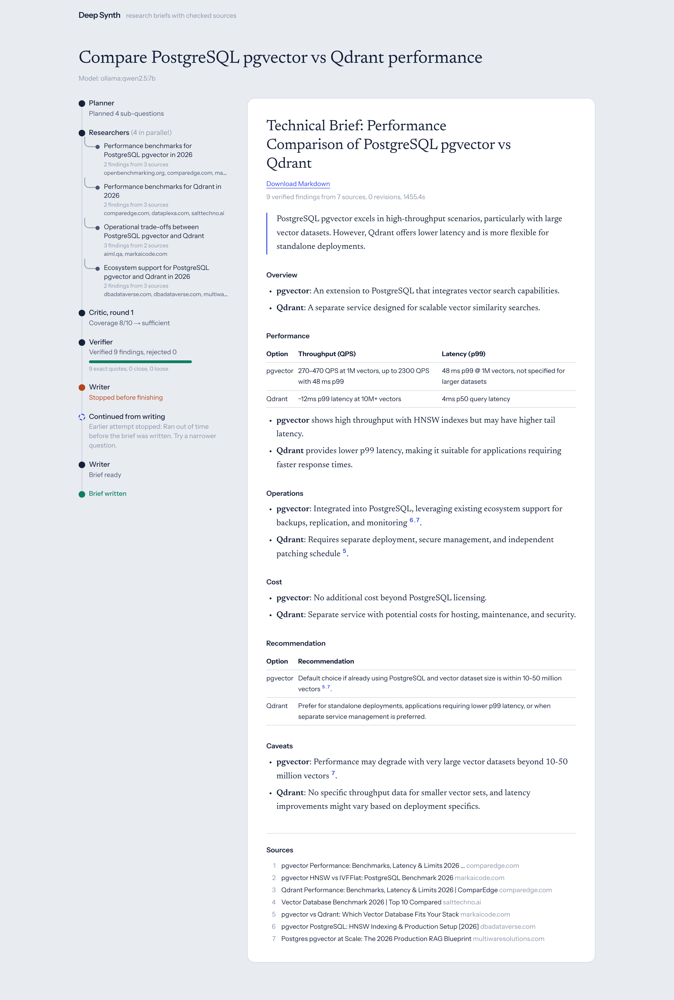

**Recover from failures.** This run hit its time limit while writing. **Continue from writing** re-runs only the failed step from the LangGraph checkpoint. The finished brief above is that same run, continued, with a marker on its timeline.

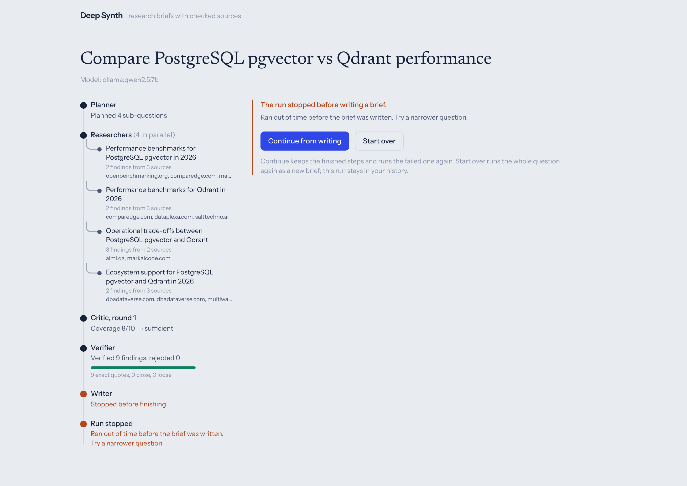

<details>
<summary>Dark mode, mobile, and API docs</summary>

| Dark mode | |
|---|---|
| 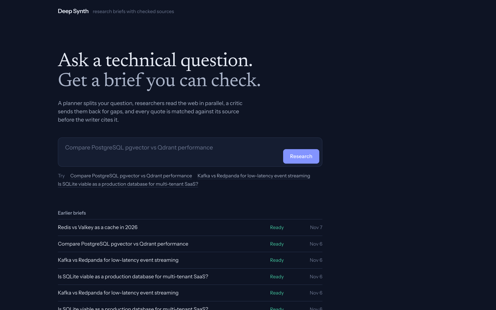 | 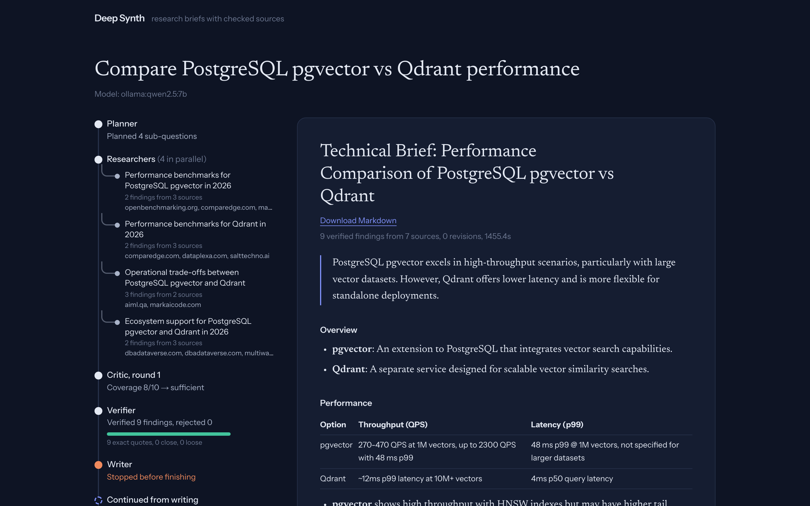 |

| Mobile: home | Mobile: timeline | Mobile: brief |
|---|---|---|
| 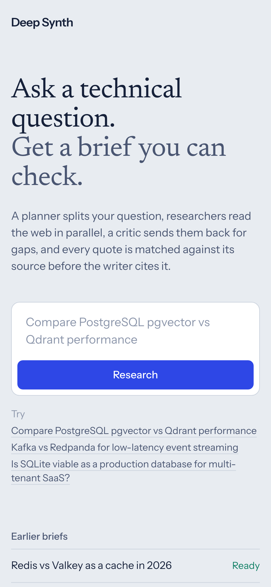 | 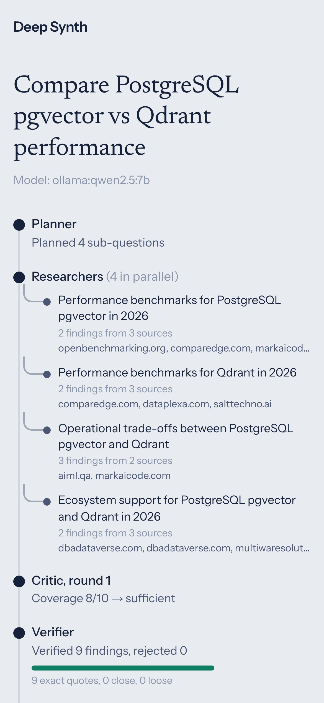 | 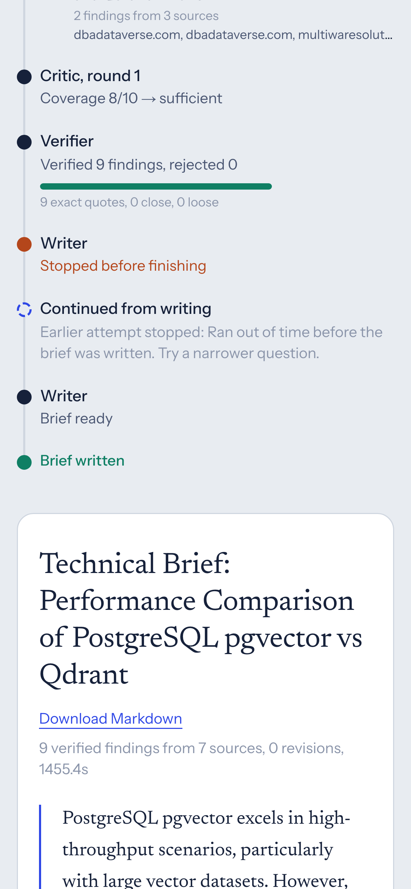 |

FastAPI's generated OpenAPI docs (`/docs`). The frontend types are generated from the same schema.

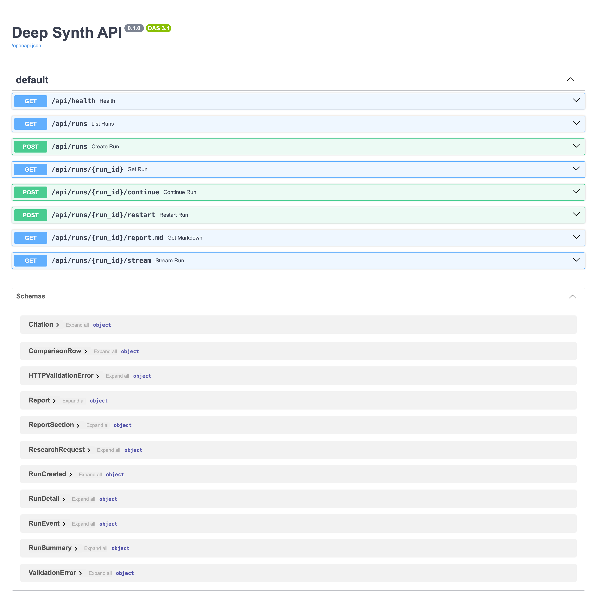

</details>

## Architecture

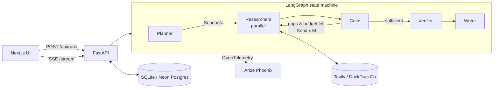

| Agent | Job | Output (Pydantic) |
|---|---|---|
| Planner | Split the topic into ≤4 non-overlapping sub-questions with search queries | `ResearchPlan` |
| Researcher ×N | Search, read top pages, extract claims with a **verbatim** evidence quote and source URL | `FindingsExtraction` |
| Critic | Score coverage, flag contradictions, request targeted follow-ups (bounded loop) | `Critique` |
| Verifier | Deterministic: fuzzy-match each quote against the stored page text; drop fabrications and duplicates; grade confidence | `VerifiedFinding[]` |
| Writer | Write the brief citing only verified findings; unknown citation numbers are stripped | `ReportDraft` → `Report` → Markdown |

### Engineering choices worth noting

- **Schema-enforced LLM I/O.** Every agent call uses native JSON-schema constrained decoding (Ollama and Gemini both support it). Output is validated with Pydantic; if it fails, the validation error is fed back to the model for up to 2 retries. Small local models need this. See `backend/app/llm.py`.
- **Hallucination guard that doesn't trust the LLM.** Researchers must quote their sources. The verifier is plain code (`rapidfuzz.partial_ratio`), not another LLM call, so it is cheap, deterministic, and testable. The tests include a fabricated quote that must be rejected.
- **Cyclic graph with hard bounds.** The critic can send researchers back up to `MAX_REVISIONS` times, but only while the time budget allows. Already-read URLs are never fetched twice.
- **Runs survive the browser.** The first SSE connection starts the graph as a background task; every connection, including that first one, only *follows* it. Closing the tab doesn't cancel the run, and a refresh or second tab replays from memory or the database. The task writes a heartbeat every 15 s, and a "running" run with no heartbeat for 90 s (server restart, frozen serverless instance) is marked interrupted instead of hanging forever. Both cases are covered by tests.
- **One provider switch.** `LLM_PROVIDER=ollama|google`. Nothing else changes.
- **Typed end to end.** Frontend types are generated from FastAPI's OpenAPI schema (`pnpm gen:types`).

## Run it locally

Prerequisites: [Ollama](https://ollama.com), [uv](https://docs.astral.sh/uv/), Node 22+, pnpm. Docker is optional and only needed for Phoenix.

```bash
make setup          # uv sync, pnpm install, ollama pull qwen2.5:7b, create .env
make dev            # Phoenix :6006, API :8000, UI :3000
```

Or run the graph from the terminal without the UI:

```bash
make research TOPIC="Kafka vs Redpanda for low-latency event streaming"
```

On an 8 GB M1, a full local run (4 sub-questions) takes about 10 minutes, because Ollama answers one request at a time. Set `MAX_SUB_QUESTIONS=2 MAX_REVISIONS=1` for quick iteration. On a machine with 16 GB or more, `OLLAMA_NUM_PARALLEL=4 ollama serve` lets the researchers really run in parallel. In production the Gemini API serves them concurrently.

Add a free [Tavily](https://tavily.com) key to `.env` for better search results. Without one, it falls back to DuckDuckGo.

### Tests

```bash
make test           # pytest: verifier, renderer, critic loop bound, full graph + API with a scripted fake LLM
make lint           # ruff + eslint + tsc
```

The graph and API tests swap in a scripted fake LLM and fake search, so they run offline in seconds. They cover:

- the revise → follow-up → sufficient loop
- the loop stopping at `MAX_REVISIONS`
- a fabricated quote being rejected
- an invented citation `[99]` being stripped
- SSE replay running the graph only once

## Observability

`make phoenix` starts Arize Phoenix locally. Set `PHOENIX_COLLECTOR_ENDPOINT=http://localhost:6006` in `.env`. Every node, LLM call (with prompt, output, and token counts) and run is traced through OpenInference's LangChain instrumentation. In production, point the same variables at a free Phoenix Cloud space.

## When a run fails

- **Automatic retry.** Every agent step retries transient failures twice (after 2 s, then 4 s): a dropped connection, a model server restart, a rate limit, 5xx errors, or an interrupted system call. Bad model output isn't retried automatically, because repeating the same prompt usually repeats the mistake.
- **Continue.** LangGraph saves a checkpoint after every step: Postgres in production, a SQLite file locally. When a run fails, the brief page offers **Continue from …**, which re-runs only what failed. Finished steps, including researcher lanes that succeeded in parallel with a failed one, are kept. A run can be continued more than once, and the timeline shows each attempt below a "Continued" marker.
- **Start over.** Runs the same question again as a new brief. The failed run stays in history.
- **Timing.** A continued run gets a fresh time budget for follow-up research, and the reported duration counts only time spent running, not the pause before you clicked Continue.

API: `POST /api/runs/{id}/continue` (409 if the run hasn't failed or nothing was saved) and `POST /api/runs/{id}/restart`. `GET /api/runs/{id}` reports `resumable` and `resume_from` for failed runs.

## Security notes

Researchers fetch URLs that come from search results, which outsiders can influence, so `backend/app/tools/fetch.py` treats every URL as hostile:

- **SSRF:** http/https only, on ports 80, 443, 8080 and 8443. A hostname is resolved once and must resolve only to public addresses. The request is then sent to that exact IP, with the original hostname kept for the `Host` header and TLS certificate check, so a second, different DNS answer (DNS rebinding) is never used. Redirects are followed by hand and each hop is checked again.
- **IPv6 tricks:** addresses that wrap an IPv4 address (NAT64, IPv4-mapped) are unwrapped and the inner address is checked. 6to4, Teredo, IPv4-compatible and other tunnel or local ranges are refused.
- **Size limits:** responses are read raw and capped at 2 MB. gzip/deflate are inflated in bounded steps, so a compression bomb can't use more memory than that, and other encodings are refused. Each fetch also has a 30 s overall time limit.
- **Rate limiting** trusts `X-Forwarded-For` / `X-Real-IP` only behind a proxy that overwrites them (`TRUST_PROXY_HEADERS`, on by default on Vercel).
- **Errors** shown to users are fixed messages; exception details stay in server logs.

The tests in `backend/tests/test_security.py` cover each of these cases.

## Deploy (Vercel)

Two Vercel projects from this one repo:

1. **API**: root directory `backend/`. Vercel auto-detects FastAPI from `app/main.py`, and `vercel.json` raises `maxDuration` to 300 s.
   - Add **Neon** from the Vercel Marketplace; it sets `DATABASE_URL`.
   - Env: `LLM_PROVIDER=google`, `GOOGLE_API_KEY` (from [AI Studio](https://aistudio.google.com/apikey)), `GEMINI_MODEL`, `TAVILY_API_KEY`, `CORS_ORIGINS=https://<your-ui>.vercel.app`, optional `PHOENIX_COLLECTOR_ENDPOINT` / `PHOENIX_API_KEY`.
2. **UI**: root directory `frontend/`. Env: `NEXT_PUBLIC_API_URL=https://<your-api>.vercel.app`.

On Vercel the run deadline drops to 270 s automatically. The critic stops requesting follow-ups once about 55% of the budget is used, leaving time to verify and write.

### Cost

| | Dev | Production |
|---|---|---|
| LLM | Ollama, $0 | Gemini API (`gemini-3-flash-preview` by default), $0 within AI Studio's free-tier limits. Confirm the current limits on the [rate-limits page](https://ai.google.dev/gemini-api/docs/rate-limits) |
| Search | DuckDuckGo, $0 | Tavily free tier: 1,000 searches/mo ≈ 150+ briefs |
| Hosting | local | Vercel Hobby + Neon free tier |
| Tracing | Phoenix in Docker | Phoenix Cloud free tier |

A typical brief makes about 7–10 LLM calls: 1 planner, 4–7 researchers, 1–2 critics, 1 writer.

## Layout

```
backend/app/
  graph/        state.py (reducers), nodes.py (agents), build.py (wiring)
  prompts/      one Markdown prompt per agent
  tools/        search.py (Tavily → DuckDuckGo), fetch.py (httpx + trafilatura)
  llm.py        provider factory + validated structured output
  schemas.py    every contract, from API request to report
  main.py       FastAPI + SSE    runner.py  graph → events    cli.py  terminal runner
frontend/
  components/   AgentTimeline (live graph), ReportView (citations), RunView (SSE)
  lib/          api client, generated types, timeline folding
```
